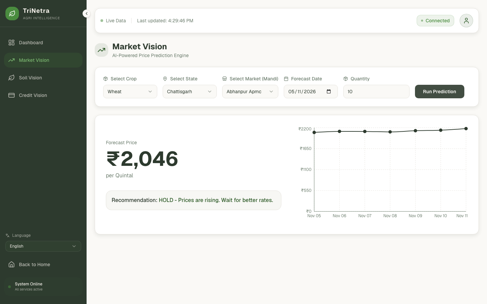

# 🌾 TriNetra: Agri-Intelligence Command Center

> **"The Third Eye for Indian Agriculture"**

**TriNetra** is a full-stack AI platform designed to empower farmers with real-time intelligence. By fusing **Satellite Imagery (GEE)**, **Generative AI (Gemini)**, and **Deep Learning (PyTorch)**, it solves the three critical pillars of farming: *Fair Prices, Soil Health, and Credit Access.*




---

## 🌟 Core Intelligence Modules

### 1. 📊 Market Vision (Price Prediction)
* **Problem:** Farmers sell low because they don't know future market rates.
* **Solution:** A small **PyTorch neural network** that maps (crop, state, date) to a price. Starting prices come from the Agmarknet CSVs in `data/`.
* **Feature:** A 7-day price trend and a hold / sell hint, with seasonality and inflation built in.
* **Limits (read this):** the two-year history the model trains on is *generated* by `train_market_ai.py` from a harvest calendar, a linear inflation term and random noise, not taken from real mandi time series. It has not been checked against real prices, so there is no accuracy figure. The `confidence` value the API returns is a fixed placeholder.

### 2. 🌱 Soil Vision (AI Agronomist)
* **Problem:** Soil reports are complex scientific data that farmers can't read.
* **Solution:** **Google Gemini 1.5 Flash** acts as a translator.
* **Feature:** Takes raw N-P-K-pH data and generates easy-to-understand advice on fertilizer dosage in local languages (Hindi, Punjabi, etc.).

### 3. 💳 Credit Vision (Satellite Verification)
* **Problem:** Farmers get rejected for loans because banks can't physically verify every farm.
* **Solution:** **Google Earth Engine (GEE)** & Sentinel-2 Satellite imagery.
* **Feature:** Instantly verifies if a GPS location is actual farmland (NDVI) and assesses water stress (NDWI) to generate an automated "Creditworthiness Score."

---

## 🛠️ Tech Stack

### **Frontend (Client)**
* **Framework:** Next.js 14 (App Router)
* **UI Library:** Tailwind CSS + Shadcn UI
* **Visualization:** Recharts (Graphs), Leaflet (Maps)
* **Language:** TypeScript

### **Backend (Server)**
* **Framework:** FastAPI (High-performance Python API)
* **Server:** Uvicorn (Port 8000)
* **Data Processing:** Pandas, NumPy
* **AI Models:** PyTorch, Google Generative AI SDK

---

## 🚀 Quick Start Guide

### Prerequisites
* **Python** 3.11 (the version this was last run on)
* **Node.js** 18+
* **Google Gemini API Key** (for Soil Vision)

### Step 1: Backend Setup (Python)

1.  **Clone the repository:**
    ```bash
    git clone https://github.com/KrishG7/TriNetra-Farmers-Stack.git
    cd TriNetra-Farmers-Stack
    ```

2.  **Install dependencies:**
    ```bash
    pip install -r requirements.txt
    ```

3.  **Configure Secrets:**
    Create a `.env` file in the root directory:
    ```env
    GEMINI_API_KEY="your_api_key_here"
    ENVIRONMENT="development"
    DEBUG=True
    ```

4.  **Start the Server:**
    ```bash
    python run.py
    ```
    ✅ **Success:** You should see `Uvicorn running on http://127.0.0.1:8000`

---

### Step 2: Frontend Setup (Next.js)

1.  **Navigate to the frontend folder:**
    ```bash
    cd frontend
    ```

2.  **Install dependencies:**
    ```bash
    npm install
    ```

3.  **Run the application:**
    ```bash
    npm run dev
    ```
    ✅ **Success:** Open **http://localhost:3000** in your browser.

---

## 🔎 Current status

Checked by running the backend and the frontend (Next.js build passes, no console errors, Market Vision works end to end):

| Area | State |
|---|---|
| Market Vision | Works. Forecasts come from a model trained on generated data (see above), and any state or crop is answered, including ones the model does not know (it falls back to a simulation). |
| Soil Vision | Needs `GEMINI_API_KEY`. |
| Credit Vision | Needs a Google Earth Engine `service_account.json` in the project root. Without it the backend logs `GEE Init Failed ... Switching to Mock Mode`, so scores are not satellite-derived. |
| Dashboard overview | The summary numbers, uptime and news items are static placeholders in `dashboard-tab.tsx`, not live data. |
| Tests | None yet. `npm run lint` reports 3 type errors. |

`service_account.json` and `.env` are in `.gitignore`. Never commit them.

---

## 📂 Project Structure

```text
TriNetra/
├── app/                  # 🐍 FastAPI Backend Code
│   ├── main.py           # API Entry Point & Routes
│   ├── services/         # Business Logic (Market, Soil, GEE)
│   └── models/           # Pydantic Schemas & PyTorch Models
├── frontend/             # ⚛️ Next.js Frontend Code
│   ├── app/              # App Router & API Proxies
│   └── components/       # UI Components (Sidebar, Tabs)
├── data/                 # 📂 CSV Data Storage (Market & Soil Data)
├── helper_functions/     # 🛠️ Maintenance Scripts (Fix Data, Check AI)
├── run.py                # Backend Launcher Script
└── train_market_ai.py    # Script to Retrain Price Model